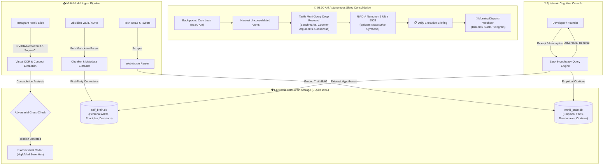

<div align="center">

# 🛡️ ANTITHECA
### *The Adversarial Vault That Thinks While You Sleep*

**Autonomous Cognitive Consolidation • Zero-Sycophancy Epistemic Memory • Dual-Brain Sovereignty**

[](https://tokenfactory.nebius.com)
[](https://build.nvidia.com)
[](https://build.nvidia.com)
[](https://tavily.com)
[](https://sqlite.org)
[](LICENSE)

*Submission for the **Nebius x NVIDIA Global AI Hackathon (Personal AI Track + $3,000 Tavily Sponsor Prize)***

<br />

| 🌐 **Live Public Demo** | 🎬 **3-Minute Video Script** | 🏆 **Devpost Manifest** | 🚀 **1-Command Start** |
| :---: | :---: | :---: | :---: |
| [`antitheca-demo.loca.lt`](https://antitheca-demo.loca.lt) | [`DEMO_VIDEO_SCRIPT.md`](DEMO_VIDEO_SCRIPT.md) | [`DEVPOST_SUBMISSION.md`](DEVPOST_SUBMISSION.md) | `./start.sh` |

</div>

---

## 📌 Executive Summary

Every software engineer, researcher, and knowledge worker suffers from the **Bookmark Graveyard**: we save hundreds of Instagram reels, architecture slides, technical tweets, and Obsidian notes, but when making high-stakes decisions, we cannot recall them.

Worse, existing personal assistants are **dangerously sycophantic**:
> If you tell ChatGPT: *"I'm thinking of breaking my solo MVP into 20 microservices with Kafka,"*  
> It replies: *"Great idea! Here is a Kubernetes manifest..."*  
> Even if three weeks ago you wrote an Architecture Decision Record (ADR 028) swearing never to introduce distributed microservices!

**AntiTheca solves this fundamentally through Autonomous Asynchronous Synthesis and Adversarial Epistemics:**
1. **Thinks While You Sleep**: An autonomous background daemon fires every night at 3:00 AM, cross-referencing your bookmarks, building topological bridges in your knowledge graph, verifying ungrounded claims via Tavily, and preparing your morning briefing with **NVIDIA Nemotron 3 Ultra 550B**.
2. **Zero-Sycophancy Adversarial Radar**: AntiTheca refuses to be a "yes-man". When you feed it a hyped reel or query, it actively searches for contradictions against your past ADRs and empirical benchmarks.
3. **Dual-Brain Sovereignty**: Strict mathematical isolation between what *you* believe (`self_brain.db`) and what the *world* claims (`world_brain.db`), audited continuously by static code drift detectors.

---

## 🏗️ System Architecture

### 1. Dual-Brain Sovereignty & Epistemic Boundary
AntiTheca strictly prevents external internet hallucinations and hyped social media claims from contaminating your personal conviction:



---

## ⚡ Dynamic NVIDIA Compute Tiering on Nebius Token Factory

AntiTheca allocates compute dynamically across specialized NVIDIA models hosted on high-throughput Nebius H100/H200 clusters:

| Model ID | Nebius Role | Why This Model? |
| :--- | :--- | :--- |
| `nvidia/Nemotron-3-Ultra-550b-a55b` | **Sleep Replay & Adversarial Arbiter** | Massive 550B parameter parameterization provides the deep reasoning required to uncover non-obvious contradictions across dozens of technical documents. |
| `nvidia/Nemotron-3.5-Super-VL` | **Multimodal Slide & Reel Extraction** | High-resolution vision parser that reads architectural flowcharts, meme graphics, and text overlays from saved video keyframes. |
| `nvidia/Nemotron-Mini-4B-Instruct` | **Real-Time Edge Ingest & Tokenization** | Ultra-low latency edge classifier for instant chunk tagging, entity disambiguation, and ADR metadata classification. |
| `tavily-ai-search` | **Empirical Web Verification** | Real-time multi-query grounding engine providing empirical benchmark citations directly to the dual-brain memory. |

---

## 🎯 Key Innovations & Capabilities

### 1. Autonomous 3:00 AM Sleep Engine (`app/scheduler.py`)
Knowledge compounds when synthesized asynchronously rather than during hurried daytime intake. AntiTheca separates rapid ingestion from overnight consolidation:
- **Decoupled Architecture**: Can run in-process for demo simplicity or as an independent background worker daemon (`python -m app.scheduler --daemon | --once`).
- **Distributed Concurrency Lock**: Features persistent SQLite state locks (`scheduler_state` table) preventing race conditions across multi-worker ASGI deployments or container cycling.
- It wakes up in the dark, traverses newly ingested graph clusters, identifies topological holes, queries Tavily for external grounding, and executes a full consolidation cycle with Nemotron 3 Ultra 550B.
- Automatically dispatches the briefing to your team's Discord/Slack webhook before you wake up.

### 2. Multi-Query Tavily Deep Research Loop (`app/tavily_client.py`)
*Direct contender for the $3,000 Tavily Sponsor Prize.*  
Rather than naive single-shot web search, AntiTheca decomposes complex claims into **3 orthogonal queries**:
1. **Empirical Benchmarks** (`"empirical benchmark comparison ..."`)
2. **Failure Modes & Counter-Arguments** (`"drawbacks failure modes and bottlenecks of ..."`)
3. **Consensus Best Practices** (`"consensus production experience with ..."`)
AntiTheca queries Tavily in parallel, deduplicates sources, computes an empirical confidence score (0-100%), and writes verified facts into `world_brain.db`.

### 3. Bulk Obsidian Vault & Local Folder Ingest (`app/ingest.py`)
- Ingests and indexes entire vaults following established Obsidian and Khoj open-source vault standards.
- Point AntiTheca at any directory of Markdown files, ADRs, or PDFs:
  ```bash
  curl -X POST http://localhost:8000/api/ingest/folder \
    -H "Content-Type: application/json" \
    -d '{"folder_path": "/absolute/path/to/your/notes"}'
  ```
- Recursively parses frontmatter, categorizes ADRs vs notes, generates embeddings, and indexes the entire vault into the graph in seconds.

### 4. Zero-Sycophancy Adversarial Radar (`app/adversarial.py`)
- Real-time detection of cognitive tension.
- When an ingested note contradicts an existing ADR (e.g. *SQLite Monolith vs 20 Microservices*), AntiTheca flags it with high severity and creates an actionable challenge requiring developer sign-off to resolve.

### 5. Static Epistemic AST Code Drift Auditor (`app/code_auditor.py`)
- An automated static analysis engine using Python's Abstract Syntax Tree (`ast.NodeVisitor`) that verifies your actual codebase complies with your ADRs:
  - **AST Import & Call Visitor**: Traverses Python module ASTs to verify **ADR 028** (Zero unauthorized message broker imports like `kafka`, `celery`, or `redis`).
  - **Database Boundary Linter**: Inspects call nodes to enforce **ADR 031** (Strict file-level boundary between `self_brain.db` and `world_brain.db`).
  - **Data Sovereignty & Secret Privacy**: Scans AST constant tokens for unredacted hardcoded API tokens.

### 6. Obsidian LLM Wiki Standard & Vault Health Linter (`app/code_auditor.py` & `app/replay_engine.py`)
- **Native Obsidian `[[Wikilinks]]`**: Notes and sleep briefings use standard bidirectional `[[wikilink]]` syntax, making the entire knowledge base natively navigable in Obsidian Graph View and Canvas.
- **Autonomous `Map_of_Content.md` (MOC)**: Generated automatically during the 03:00 AM sleep replay cycle, organizing your vault into Architecture Decisions (ADRs), Engineering Principles, Active Contradictions, and Empirical Benchmarks.
- **Epistemic Vault Health Linter (`wiki-lint`)**: Scans for broken wikilinks, orphan thoughts (notes with 0 connections), and empty stubs to keep your knowledge graph clean and compounding over time.

### 7. Native PARA Architecture & Dynamic Vault Map (`Meta/vault-map.md`)
- Adheres to the established **PARA (Projects, Areas, Resources, Archive)** knowledge organization standard.
- Reads `Meta/vault-map.md` to dynamically route knowledge atoms:
  - `00-Inbox/`: Unprocessed brain dumps, transcripts, and mobile captures pending sleep replay.
  - `01-Projects/`: Active milestones and engineering deliverables.
  - `02-Areas/`: Long-term responsibilities, principles, and active ADRs.
  - `03-Resources/`: Technical whitepapers, benchmarks, and external cheatsheets.
  - `04-Archive/`: Superceded ADRs, completed sprints, and decayed knowledge.

### 8. Temporal Commitment & Deadline Radar (`app/temporal_radar.py`)
- Automatically parses messy brain dumps, meeting notes, and voice transcripts for hidden deliverables and deadlines (e.g. *"submit video by Thursday 5pm"*, *"follow up with Alex before sprint review"*).
- Extracts urgency level, deadline timeframe, and source note link.
- Injects critical upcoming deadlines directly into your morning Discord/Slack webhook dispatch and the Adversarial Radar UI.

### 9. 5-Phase Cognitive Defrag & Tag Garden Hygiene (`app/code_auditor.py`)
- **Tag Garden Audit**: Identifies orphan tags (used only once) and suggests merges for near-duplicate taxonomy terms (e.g. `#infrastructure` → `#infra`).
- **Knowledge Decay Detection**: Detects stale notes with zero incoming links and flags them as archival candidates for `04-Archive/`.
- **Structural Defrag Report**: Generates an actionable hygiene markdown audit during the 3:00 AM sleep replay or on-demand.

### 10. NVIDIA OpenShell & NemoClaw Isolation Guard (`backend/app/sandboxes/`)
- **Containerized Network & Scraping Isolation**: Wraps untrusted external URL fetches, web articles, and reel transcript scraping inside NVIDIA OpenShell sandboxes.
- **Kernel-Level Policy Enforcement**: Restricts filesystem access (`DENIED` outside scratch buffers), enforces HTTP/HTTPS egress allowlists, and protects against indirect prompt injection attacks from adversarial web pages.
- **Graceful Fallback & Live Telemetry**: Reports real-time containment posture via `/api/status` and surfaces the OpenShell Security Badge directly in the navigation console.

### 11. Hermes Agent Epistemic Guard Skill (`integrations/hermes/`)
- **Autonomous Conscience for Hermes**: Provides a production-grade tool skill (`SKILL.md` + `antitheca_skill.py`) enabling Nous Hermes agents to consult AntiTheca before executing commands.
- **Zero-Sycophancy Gatekeeper**: When a user instructs Hermes to carry out an architectural shift (e.g. *"Convert monolith into 20 microservices"*), Hermes queries AntiTheca first, receives an ADR 028 tension warning, and halts execution to challenge the user rather than blindly generating contradictory code.

### 12. Nebius Serverless AI Batch Job (`deploy/nebius_serverless/`)
- **Zero-Idle Cloud Consolidation**: Packages the 3:00 AM Autonomous Sleep Engine into an ephemeral container job specification (`job_spec.yaml` + `Dockerfile.job`).
- **On-Demand H100/CPU Trigger**: Runs on a scheduled cron trigger (`0 3 * * *`) on Nebius Serverless AI Jobs, mounts the sovereign vault volume, executes Tavily research + Nemotron 3 Ultra 550B synthesis, dispatches webhooks, and immediately exits with $0 idle compute cost.

---

## 🚀 Quickstart Guide

### Option A: Docker Compose (1-Command Startup)
```bash
# 1. Clone repository
git clone https://github.com/VinayK8866/antitheca--Nvidia-X-Nebius-Hackathon.git
cd antitheca--Nvidia-X-Nebius-Hackathon

# 2. Configure environment
cp .env.example .env
# Edit .env with your NEBIUS_API_KEY and TAVILY_API_KEY

# 3. Start AntiTheca (Backend + Frontend)
docker compose up --build
```
Open **`http://localhost:3000`** in your browser.

---

### Option B: Local Development
```bash
# 1. Clone & Enter
git clone https://github.com/VinayK8866/antitheca--Nvidia-X-Nebius-Hackathon.git
cd antitheca--Nvidia-X-Nebius-Hackathon

# 2. Configure keys
cp .env.example backend/.env
# Add your NEBIUS_API_KEY and TAVILY_API_KEY in backend/.env

# 3. Launch via 1-click script
./start.sh
```
- **Web App**: `http://localhost:3000`
- **FastAPI OpenAPI Docs**: `http://localhost:8000/docs`

---

## 🧪 Testing with the Built-in Demo Vault

AntiTheca comes pre-packaged with a realistic engineering vault (`backend/demo_vault/`):
- `ADR_045_State_Management.md`: Rejection of Redis in favor of SQLite WAL for single-node efficiency.
- `ADR_052_Compute_Tiering.md`: Tiered orchestration across NVIDIA Nemotron models.
- `PostgreSQL_vs_SQLite_Debate.md`: Deep comparison of operational complexity.
- `Microservices_Anti_Pattern_Notes.md`: Real-world postmortems on microservice bloat.
- `Autonomous_Agent_Memory_Loops.md`: Cognitive replay loop design patterns.

**To ingest the sample vault:**
1. Open the AntiTheca Console at `http://localhost:3000/?tab=console`.
2. Click the **"Vault Bulk"** tab.
3. Click **"Load Sample Engineering Vault (5 Notes & ADRs)"** -> Ingest into Brain.
4. Watch the Knowledge Graph and Adversarial Radar illuminate instantly!

---

## 📊 Live Interactive Endpoints

| Endpoint | Method | Description |
| :--- | :--- | :--- |
| `/api/replay/latest` | `GET` | Retrieve the latest overnight executive briefing generated by Nemotron 3 Ultra 550B. |
| `/api/replay/schedule/trigger` | `POST` | Simulate the 03:00 AM autonomous cron sleep consolidation cycle. |
| `/api/dispatch/test` | `POST` | Dispatch the briefing to a custom Discord/Slack/Telegram webhook. |
| `/api/research/deep` | `POST` | Run 3-query Tavily Deep Research on any claim or technical topic. |
| `/api/ingest/folder` | `POST` | Recursively ingest an entire Obsidian vault or local folder. |
| `/api/ingest/file` | `POST` | Multimodal OCR and concept extraction from images using `Nemotron-3.5-Super-VL`. |
| `/api/audit/code` | `GET` | Run static code auditor to verify compliance with documented ADRs. |
| `/api/challenges` | `GET` | Retrieve active adversarial challenges and epistemic contradictions. |
| `/api/query` | `POST` | Zero-sycophancy query console with ground-truth RAG and proactive citations. |

---

## 🏆 Hackathon Alignment & Track Checklist

- [x] **Primary Track: Personal AI**: Solves personal knowledge retention, bookmark overload, and cognitive drift with zero-sycophancy memory.
- [x] **Nebius Token Factory Integration**: High-throughput orchestration across `nvidia/Nemotron-3-Ultra-550b-a55b` and `nvidia/Nemotron-3.5-Super-VL`.
- [x] **Tavily Sponsor Prize Candidate**: Implemented orthogonal 3-query Deep Research loop with source deduplication and confidence scoring.
- [x] **Open Source Sovereignty**: 100% MIT License, local-first SQLite WAL dual-database storage, zero proprietary cloud lock-in.

---

## 📄 License
This project is licensed under the MIT License — see the [LICENSE](LICENSE) file for details.
